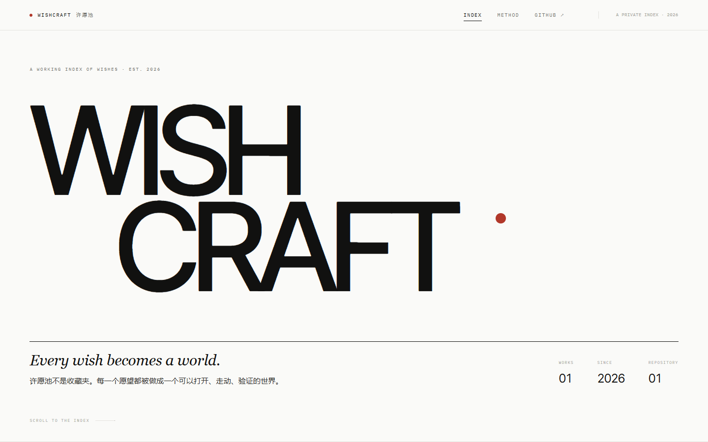
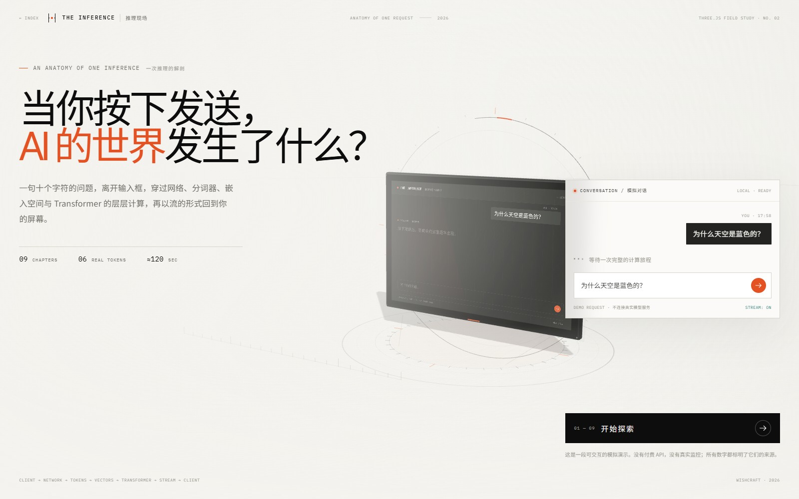

# WISHCRAFT · 许愿池

> A pool of wishes, each built into a world.
> 一个把愿望做成可运行世界的仓库。

**在线作品集：** https://120403.xyz/wishcraft/ （GitHub Pages；`my-final.github.io/wishcraft` 会跳转到同一站点）

当前收录 **03 个作品**：

## THE INTELLIGENCE ARCHIVE / 智能编年史

> 从图灵的第一个问题，到能够自主执行任务的人工智能。1950—2026。

交互式纪录片：滚动叙事、三维智能纪念碑、全球模型星图、推理树、Agent 工作系统，以及可检索的完整模型档案。

- **数据**：181 个模型 / 93 条历史事件 / 44 家机构
- **核实**：每个模型与事件标注日期类型、日期精度、官方来源与核实等级；无法核实项不出现在数据中
- **档案**：`#/archive` 搜索、筛选、时间轴、模型详情、真实继承关系图谱
- **技术**：Vite + React + TypeScript + Three.js；静态部署，无后端
- **入口**：`projects/intelligence-archive/`；项目内文档见 `docs/DATA_REPORT.md`、`docs/VERIFICATION.md`、`docs/SOURCES.md`



## THE INFERENCE / 推理现场

> 当你按下发送，AI 的世界发生了什么？

一次大语言模型请求的完整生命周期：从聊天框里的十个字符，到 HTTPS、API 网关、Tokenizer、Embedding、Transformer、Prefill、Decode，再到逐 Token 抵达屏幕。九段可自由探索的三维章节，一座可以走进的推理机器。

- **章节**：09 段连续叙事，120 秒主时间轴，可暂停、回放、拖拽、0.5×/1×/2×、直接跳章
- **交互**：鼠标/触控旋转与缩放、点击 3D 节点、Token 检视、公式深潜、Web/API 与 Dense/MoE 切换、Temperature 采样实验、自由探索全景
- **真实数据**：输入问题 `为什么天空是蓝色的？` 使用 Qwen2.5-0.5B-Instruct 的**真实 tokenizer**，10 个汉字 → 6 个 Token（`100678, 101916, 20412, 105681, 9370, 11319`）；回答 55 Token 的边界来自同一 tokenizer
- **模拟边界**：延迟、吞吐、KV Cache 占用、attention 权重、logits、三维 embedding 坐标均为**明确标注的模拟/概念可视化**，不是模型真实内部激活；不展示隐藏思维链
- **技术**：Vite + React + TypeScript + Three.js；纯静态、无后端、无真实 API 调用；自托管字体、桌面优先、移动简化、支持 `prefers-reduced-motion`
- **入口**：`projects/inference/`；项目文档见 `projects/inference/README.md`、`docs/QA_REPORT.md`



## GARGANTUA / 卡冈图雅

> 每一个像素，都是一条弯折的零测地线。

全屏 Fragment Shader 实时积分 Schwarzschild 零测地线的黑洞作品。没有黑球、平面圆环、贴图或视频：事件视界、光子环、引力透镜、吸积盘背面与多次穿越，全部由每一帧、每一个像素的 Binet 方程数值积分产生。

- **物理**：RK4 积分 `d²u/dφ² + u = 3Mu²`（`u = 1/r`）；`r_s = 2M = 1`，光子球 `1.5 r_s`，ISCO `3 r_s`，临界碰撞参数 `3√3 M ≈ 2.598 r_s`
- **相对论光学**：Keplerian 吸积盘、Doppler beaming、引力红移与观测频率偏移；盘面湍流随差速旋转演化
- **程序化天空**：程序化星场与银河带，无全景贴图；天空同样经过测地线透镜
- **后处理**：HDR bloom、ACES、暗角、胶片颗粒、轻微色散；Standard / High / Cinematic 三档质量
- **交互**：电影镜头循环、OrbitControls、4 个视角预设、HUD、**21 项**实时参数、`0–9` 调试视图、快捷键、可选环境音乐
- **工程**：原生 HTML/CSS/JS + ES Modules + 本地 Three.js，**无构建步骤**；URL 截图接口、状态持久化、WebGL 上下文恢复、Retina 与移动端适配
- **入口**：`projects/gargantua/`；项目文档见 `projects/gargantua/README.md`、`docs/PHYSICS.md`、`docs/QA_REPORT.md`


---

## 仓库结构

```text
wishcraft/
├─ site/                    作品集（纯 HTML/CSS/JS，无构建依赖）
│  ├─ index.html · styles.css · app.js
│  ├─ assets/covers/        作品封面
│  └─ fonts/                自托管 Inter Tight / IBM Plex Mono
├─ scripts/
│  ├─ build-site.mjs        发现 → 构建 → 组装 _site/
│  ├─ serve-site.mjs        本地预览 _site/
│  ├─ make-covers.mjs       从构建产物生成封面
│  └─ test-site.mjs         Playwright 验收脚本
├─ projects/
│  ├─ intelligence-archive/ THE INTELLIGENCE ARCHIVE / 智能编年史
│  ├─ inference/            THE INFERENCE / 推理现场
│  └─ gargantua/            GARGANTUA / 卡冈图雅
└─ .github/workflows/pages.yml
```

## 本地运行

```bash
# 只组装作品集（复用已安装依赖，最快）
node scripts/build-site.mjs --skip-install
node scripts/serve-site.mjs          # http://127.0.0.1:5180/

# 完整构建：为每个项目安装依赖并执行各自的 build
node scripts/build-site.mjs
```

单独开发某个作品：

```bash
cd projects/intelligence-archive
pnpm install
pnpm dev          # http://127.0.0.1:5178

cd projects/inference
pnpm install
pnpm dev          # http://127.0.0.1:5181
pnpm build        # tsc --noEmit + vite build
pnpm qa           # 浏览器验收（需先启动 5190 端口的 preview）

# GARGANTUA 无需构建：任意静态服务器即可（不能直接 file:// 打开，ES Modules 需要 HTTP）
cd projects/gargantua
python -m http.server 5192 --bind 127.0.0.1   # http://127.0.0.1:5192/
node tools/qa.mjs                              # Playwright 验收（需先启动上面的静态服务器）
```

## 以后如何再许一个愿

这个仓库的构建器是通用的。新增作品只需：

1. 在 `projects/` 下新建目录，放入任意可构建的网页工程（Vite / React / Three.js / 单文件 HTML 均可）。
2. 写一个 `wish.json`：

```json
{
  "id": "my-wish",
  "order": 3,
  "title": "MY WISH",
  "titleZh": "我的愿望",
  "year": "2026",
  "kind": "INTERACTIVE",
  "kindZh": "交互式网页",
  "status": "WIP",
  "tagline": "一句可以印在作品集上的话。",
  "description": "两到三句作品说明。",
  "meta": ["2026", "SINGLE PAGE"],
  "preview": "projects/my-wish/",
  "cover": "assets/covers/my-wish.jpg",
  "build": {
    "manager": "pnpm",
    "command": "pnpm build",
    "output": "dist"
  }
}
```

3. 可选：封面放到 `site/assets/covers/my-wish.jpg`（1600×1000）。
4. 提交并 push 到 `main`。Actions 会构建所有项目、生成作品集并发布；导航里会出现新的世界。

### `wish.json` 字段

| 字段 | 必填 | 说明 |
|---|---|---|
| `id` | 是 | URL 安全、全局唯一；预览地址为 `projects/<id>/` |
| `title` / `titleZh` | 是 | 英文主标题 / 中文标题 |
| `order` | 否 | 作品集排序，数字小的在前 |
| `year` / `kind` / `kindZh` / `status` | 是 | 年份、英文类型、中文类型、状态 |
| `tagline` / `description` / `meta` | 是 | 索引副标题、详情描述、三条元数据 |
| `preview` | 否 | 预览路径；默认 `projects/<id>/` |
| `cover` | 否 | 相对 `site/` 的封面路径；缺省显示排版占位 |
| `build` | 是 | `manager`（pnpm/npm）· `command` · `output`（目录或单文件） |
| `build.mode` | 否 | 设为 `"static"` 时不做构建，直接复制 `source`；可用 `files[]` 附带额外文件 |

构建器会把产物落到 `_site/projects/<id>/index.html`；单文件 HTML 会重命名为 `index.html`。

## GitHub Pages

仓库已包含 `.github/workflows/pages.yml`，Pages 的 Source 已设为 **GitHub Actions**。push 到 `main` 或在 Actions 里手动运行即可发布。

所有资源与导航均使用相对路径，因此可以部署在仓库子路径下。当前 Pages 绑定了自定义域名 `120403.xyz`，站点地址为：

**https://120403.xyz/wishcraft/**

## 已验证

- 干净 clone 后从零安装、构建全部作品并组装 `_site/`：通过；
- GitHub Actions 构建与部署：成功；
- 线上作品集、智能编年史入口、封面、字体：HTTP 200；
- 作品集详情 → 进入作品 → 返回：正常；
- 1440×900、1024×768 与 390×844 排版检查：通过；
- 智能编年史本身：`tsc` 0 error，`vite build` 通过，181/93/44 数据校验 0 硬错误；
- 推理现场本身：`tsc` 0 error，`vite build` 通过，Playwright 验收 **33/33** 通过（桌面、移动、reduced-motion；零 console/page error），关键 3D 节点、Token 检视、深潜、模式切换、Temperature、时间轴与自由探索均有覆盖；记录见 `projects/inference/docs/QA_FINAL.json`。
- 卡冈图雅本身：无构建静态站点，`node scripts/build-site.mjs --only=gargantua --skip-install` 通过，`/projects/gargantua/` 子路径资源零 404；物理自检 **9/9 PASS**（`projects/gargantua/tools/physics-check.mjs`）；Playwright 验收 **58/58 PASS**（0 failed / 0 skipped，零 console error / page error / console warning、零 HTTP ≥ 400），覆盖 21 参数、0–9 调试视图与确定性渲染、4 预设、3 档质量、移动端/Retina/reduced-motion、状态持久化、URL 截图确定性、WebGL 丢失/恢复、音频与静态子路径；记录见 `projects/gargantua/docs/QA_REPORT.md`、`docs/QA_FINAL.json`，验收截图见 `projects/gargantua/docs/evidence/`。

## 反馈与许愿

- **发现不对**：用「纠错」模板，尽量附上官方来源。
- **想加点什么**：用「新愿望」模板；第 5 栏可以直接贴你希望我执行的提示词。
- **打不开 / 坏了**：用「站点问题」模板，附 URL、设备和复现步骤。
- **补模型 / 改数据**：用「模型 / 数据补充」模板，重点写清官方来源与日期类型。
- **直接改代码或加新作品**：提 PR，模板会逐项引导填写。

[打开 Issue 模板](https://github.com/MY-Final/wishcraft/issues/new/choose) · [查看 PR 模板](https://github.com/MY-Final/wishcraft/blob/main/.github/pull_request_template.md)

## 来源与授权

智能编年史的数据来源、核实等级与无法核实项见项目内 `docs/DATA_REPORT.md`、`docs/VERIFICATION.md`、`docs/SOURCES.md`。推理现场的 tokenizer 数据来自 `Qwen/Qwen2.5-0.5B-Instruct`（revision `7ae557604adf67be50417f59c2c2f167def9a775`），来源与校验记录见项目内 `research/TOKENIZER_NOTES.md`；其余运行时数值与三维结构为模拟/概念可视化。卡冈图雅的星场、银河、吸积盘纹理与全部画面均由 GLSL 程序化实时生成，没有任何贴图、视频或截图素材；本地 Three.js 为 MIT 许可（`projects/gargantua/vendor/three/LICENSE`），环境音乐为程序化合成、以 CC0 1.0 释出（`projects/gargantua/assets/audio/README.md`）。所有第三方模型与机构名称归其各自所有者。
