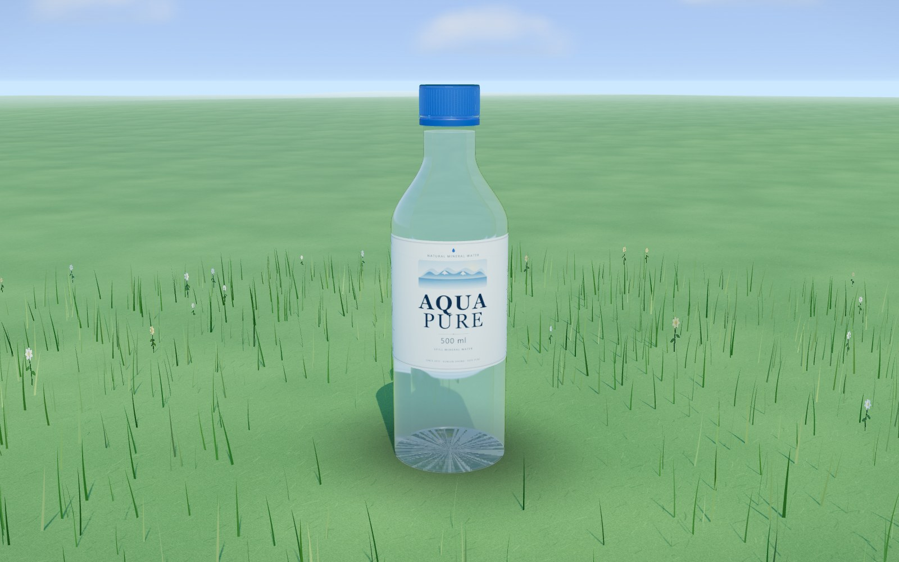
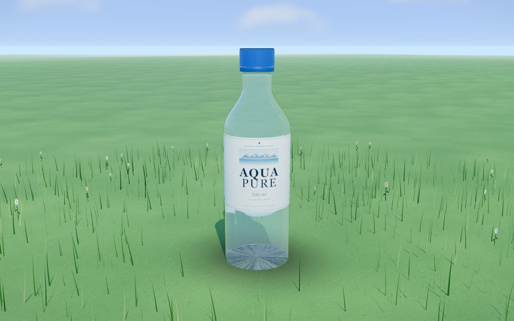
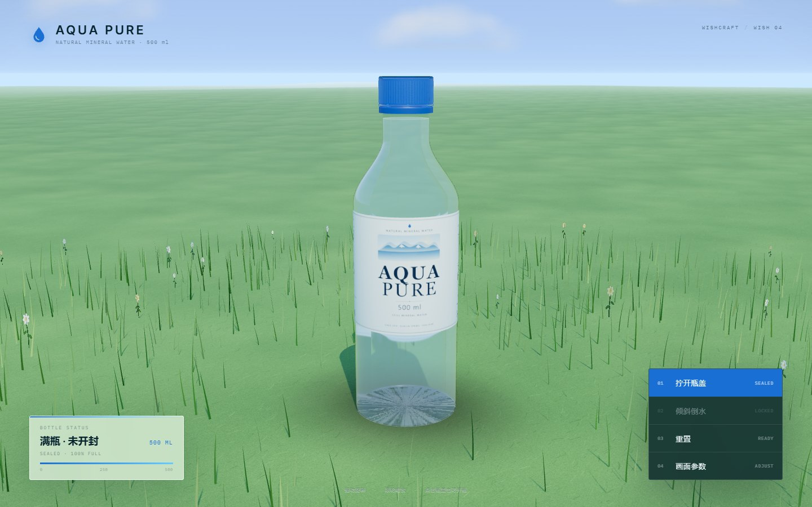
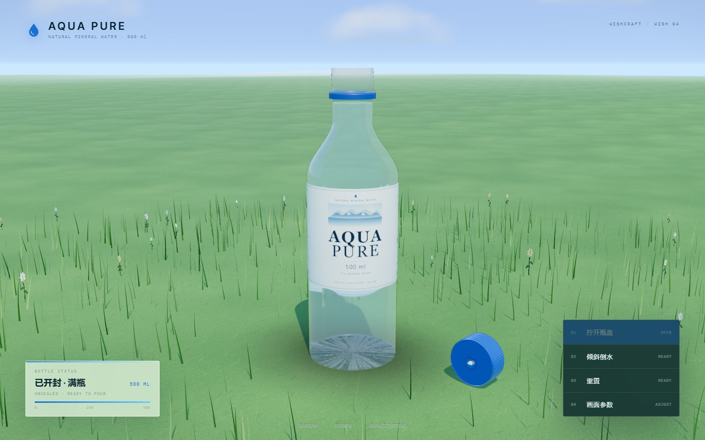
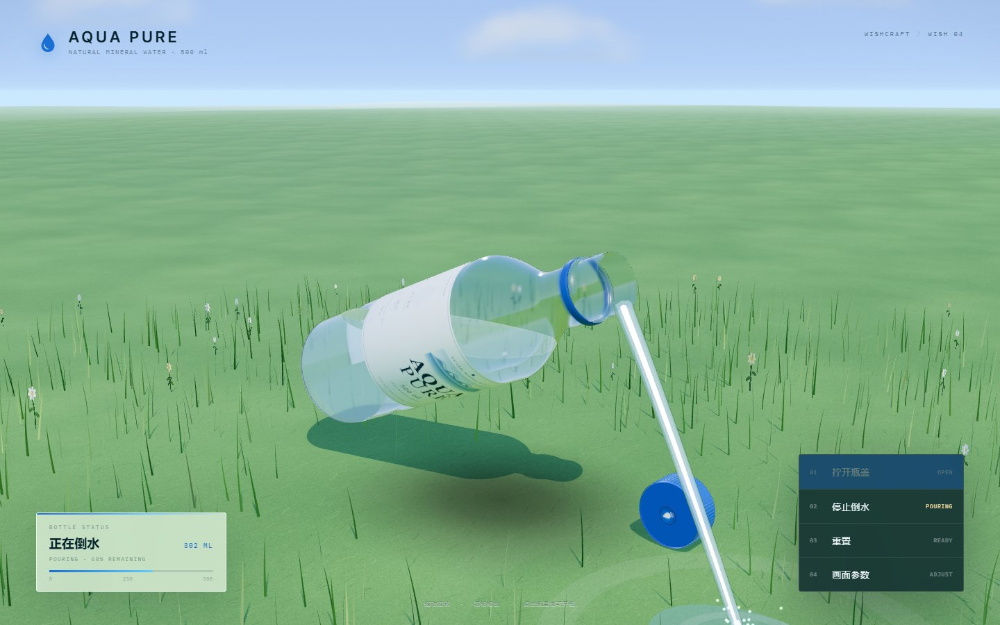
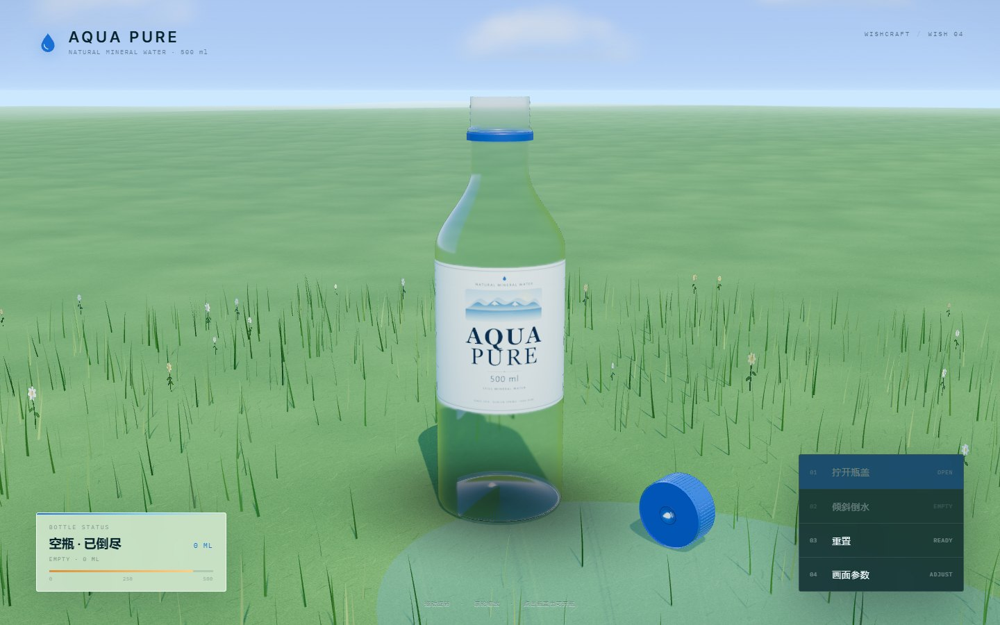
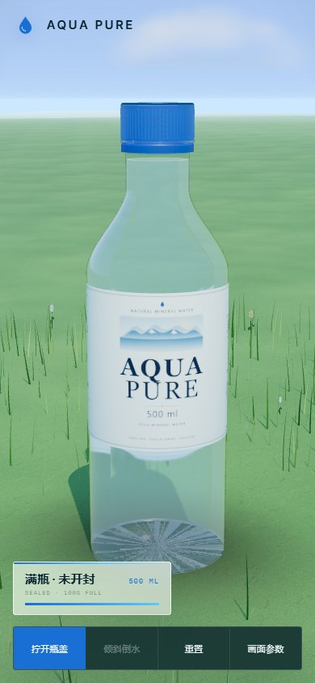

# AQUA PURE / 满瓶之水

> 一瓶 500ml 的水，从满到空。

**Interactive Product Study** — 一个用 Three.js 程序化构建的超拟真 500ml PET 矿泉水瓶。满瓶、未开封，立在蓝天白云的草地上；拧开瓶盖、倾斜瓶身，水从瓶口流出，水面始终与重力保持水平，直到空瓶。所有几何、材质与贴图均由代码实时生成，没有任何外部模型、图片或 HDRI。

- 在线入口（作品集内）：`https://120403.xyz/wishcraft/` → `projects/aqua-pure/`
- 本地入口：`node tools/serve.mjs` → `http://127.0.0.1:5194/`
- 技术：原生 HTML / CSS / JavaScript + ES Modules + 本地 Three.js r187（MIT）；无构建步骤、无后端、无外部资源
- 原始愿望：[MY-Final/wishcraft#4](https://github.com/MY-Final/wishcraft/issues/4)



---

## 运行

ES Modules 需要 HTTP 环境，直接双击 `index.html`（`file://`）无法加载。

```bash
# 方式 A：项目内零依赖静态服务器
cd projects/aqua-pure
node tools/serve.mjs                 # http://127.0.0.1:5194/

# 方式 B：从仓库根目录构建并预览整个作品集
node scripts/build-site.mjs --only=aqua-pure --skip-install
node scripts/serve-site.mjs          # http://127.0.0.1:5180/projects/aqua-pure/
```

推荐近期版本的 Chrome / Edge / Firefox / Safari，需要 WebGL 2。不支持时页面会显示可读的降级说明，而不是黑屏。

### 验收与截图

```bash
# 浏览器验收（自带静态服务器与临时端口；使用仓库 inference 项目的 playwright-core）
node tools/qa.mjs                     # → docs/QA_FINAL.json + docs/screens/qa-*.jpg

# 生成作品集封面（1600×1000）
node tools/cover.mjs                  # → site/assets/covers/aqua-pure.jpg
```

---

## 操作

| 操作 | 效果 |
| --- | --- |
| 拖动 / 滚轮 | 带阻尼的轨道观察；闲置数秒后恢复缓慢自动旋转 |
| 点击「拧开瓶盖」或直接点击瓶盖 | 瓶盖旋转、上提、飞出并落到草地上；8 个防盗环连接桥断裂，防盗环留在瓶颈 |
| 点击「倾斜倒水」 | 瓶身绕横轴倾斜 72°，水面保持世界水平，水柱从瓶口落到草地，水量持续减少 |
| 再次点击「停止倒水」 | 瓶身扶正，剩余的水留在瓶内 |
| 点击「重置」 | 回到满瓶、未开封的初始状态 |
| 右下角「画面参数」 | 实时调整曝光、环境反射强度、水量与自动旋转 |
| `O` / `P` / `R` | 开盖 / 倒水 / 重置快捷键 |

URL 自动化接口（用于截图与 QA）：

```
?shot=1&ui=0&pose=pour&fill=0.55&tilt=72
```

`window.__AQUA__` 暴露 `ready`、`getState()`、`openCap()`、`togglePour()`、`reset()`、`setFillFraction()`、`setExposure()`、`setEnvironmentIntensity()`、`setCameraPreset()`、`setPose()`、`screenshot()`、`getRenderInfo()`。

---

## 「满瓶、未开封」的七个视觉证据

| # | 特征 | 实现 |
| --- | --- | --- |
| 1 | 液面在瓶颈下方、肩部上方，形成上凸弯月面 | 水面是独立的世界空间网格；中心比边缘高 0.5mm，边缘贴合内壁 |
| 2 | 瓶盖拧到底，8 个防盗环连接桥完好 | 瓶盖与 4mm 防盗环为分件几何；8 根真实连接桥在初始状态完整可见，开盖瞬间断裂 |
| 3 | 瓶身受内压微鼓 | 瓶身轮廓按满瓶内压设置；圆柱段带 ±0.15mm 级顶点噪声 |
| 4 | 中段两侧对称捏痕 | 顶点位移形成 2.6mm 深、25mm 高的拇指凹槽，标签不覆盖 |
| 5 | 液面反光 | 弯月面使用 transmission + clearcoat，并叠加高光边缘线 |
| 6 | 瓶内无气泡、无空隙 | 水体是贴合内壁的封闭旋转体，液面以下完全填满 |
| 7 | 标签完整包裹、无翘边 | 2048×716 程序化 CanvasTexture，360° 无缝包裹，半径外偏 0.16mm 防 z-fighting |

---

## 真实感与工程取舍

### 瓶身

- **单一封闭薄壳**：从瓶底凹槽到瓶口内壁的完整 2D 轮廓通过 `LatheGeometry` 旋转 128 段，形成 0.35mm 厚的真实 PET 壳；内外壁共用同一材质，避免两层折射面互相打架。
- **真实几何螺纹**：3.5 圈螺旋线沿瓶颈扫掠 `TubeGeometry`，不是法线贴图。开盖后可直接看到。
- **瓶底花瓣脚**：5 个扁平支撑脚与凹入 8mm 的 punt 组合，瓶底与草地之间只有脚点接触。
- **瓶盖**：圆形凹印顶面、64 条竖向防滑凸纹（InstancedMesh）、防盗环内侧 20 个卡齿。蓝色 `#1a6fd4`，roughness 0.35，clearcoat 0.5。
- **标签**：Canvas 2D 绘制，包含品牌、山水插画、500ml、营养成分表、条形码与水源信息；`SRGBColorSpace` + anisotropy。

### 水

- **水体**：与瓶身内壁同样通过旋转体构建，逐点内缩 0.35mm，并对捏痕区域做同样的径向位移，避免水穿出瓶壁。
- **水面**：每帧根据瓶身当前姿态，把世界水平面（`y = H`）与瓶内壁求交，重建一个世界空间自由表面网格；因此液面永远垂直于重力方向，倾斜时不会跟着瓶身歪。
- **裁剪**：水体使用世界空间 `clippingPlanes` 裁掉液面以上部分；裁剪面与自由表面严格重合，避免穿帮。
- **倒水**：先按当前倾角计算瓶口最低点以下可容纳的水量（多出的水立即溢出），到达最大倾角后按 8.5%/秒 排水；水流为带锥度的动态 TubeGeometry，落到草地后生成水花粒子与水洼涟漪。
- **透明度**：瓶身与水体都使用 `transmission`（不叠加 `opacity`）；水体 `depthWrite: false`，渲染顺序为瓶身 4 / 水面 6 / 水柱 8 / 高光 9。

### 环境

- **天空**：程序化 ShaderMaterial 天空穹顶，地平线浅蓝到天顶深蓝，太阳方位与主平行光一致，带大气散射光晕与色散抖动。
- **云**：5 张程序化 CanvasTexture 云贴图，15 组双层 Sprite，按不同角速度极缓慢漂移。
- **草地**：26000mm 大平面 + 无缝程序化草纹理（90 次重复）+ 3600 株近景实例化草叶（顶点着色器风吹摆动）+ 50 株野花。
- **光照**：暖白 DirectionalLight 太阳（2048 阴影贴图、PCFSoftShadow）+ HemisphereLight 天空补光 + 冷色轮廓光；ACES 色调映射、sRGB 输出。
- **环境反射**：把程序化天空 + 草地渲染进 `PMREMGenerator`，作为 `scene.environment`；这是透明 PET 在户外强光下不发灰、不发黑的关键。

### 性能取舍

- 瓶身 128 径向段、水体 128 段；近景草 3600 实例、远景用贴图 + 雾。
- 水面与水体用解析轮廓而不是体素/CSG，每帧只更新约 200 个顶点的自由表面。
- 水花 260 个粒子、水洼 1 个圆片 + 3 个涟漪环。
- 像素比上限 2×；移动端自动降低 UI 密度。

---

## 工程结构

```text
projects/aqua-pure/
├─ index.html                 importmap + canvas + 语义化控制面板
├─ styles/
│  ├─ base.css                字体、画布、氛围、品牌、加载与错误态
│  └─ hud.css                 状态卡、操作 dock、参数抽屉、响应式
├─ src/
│  ├─ config.js               全部尺寸 / 颜色 / 材质 / 时序参数
│  ├─ profile.js              瓶身截面数学：外轮廓、内半径、捏痕、体积
│  ├─ bottle.js               瓶身、瓶盖、防盗环、螺纹、瓶底花瓣脚
│  ├─ label.js                2048×716 程序化标签贴图
│  ├─ water.js                水体、世界水平液面、水柱、水花、水洼
│  ├─ environment.js          天空、云、草地、光照、PMREM 环境
│  ├─ ui.js                   DOM 控制与状态文案
│  └─ main.js                 渲染器、相机、状态机、动画循环、自动化 API
├─ vendor/three/              本地 Three.js r187（core + OrbitControls + MIT LICENSE）
├─ assets/fonts/              自托管 Inter Tight / IBM Plex Mono
├─ tools/                     serve.mjs / qa.mjs / cover.mjs
├─ docs/                      QA_FINAL.json + screenshots
└─ wish.json                  作品集集成描述（静态构建）
```

- **无构建**：浏览器直接加载 ES Modules；`wish.json` 使用 `build.mode = "static"`。
- **无外部依赖**：Three.js 已本地 vendor；没有 CDN、字体、贴图、模型或视频。

---

## 验证

- **浏览器验收**：`node tools/qa.mjs` → **26/26 PASS**（0 failed），零 console error / page error / HTTP ≥ 400；覆盖初始满瓶、开盖（真实按钮点击）、瓶口俯视液面、倾斜倒水、空瓶水洼、重置、移动端 390×844。记录见 [`docs/QA_REPORT.md`](docs/QA_REPORT.md)、[`docs/QA_FINAL.json`](docs/QA_FINAL.json)，证据截图见 [`docs/screens/`](docs/screens/)。
- **语法**：`node --check` 通过全部 8 个源文件与 3 个工具脚本。
- **作品集构建**：`node scripts/build-site.mjs --only=aqua-pure --skip-install` 通过，`_site/projects/aqua-pure/` 下所有 JS / CSS / 字体 / vendor 资源齐全。
- **截图 / 封面**：`node tools/cover.mjs` 生成 `site/assets/covers/aqua-pure.jpg`（1600×1000）。

### 验收截图

| | |
| --- | --- |
|  |  |
| 满瓶、未开封，草地与蓝天 | 桌面控制 dock / 状态卡 |
|  |  |
| 瓶盖落到草地，防盗环留在瓶颈 | 倾斜 68°，水面保持世界水平 |
|  |  |
| 空瓶与草地水洼 | 390 × 844 响应式布局 |

## 授权

- 本项目原创代码与画面：随 WISHCRAFT 仓库发布。
- Three.js r187：MIT，见 [`vendor/three/LICENSE`](vendor/three/LICENSE)。
- 字体 Inter Tight / IBM Plex Mono：SIL Open Font License，文件来自作品集站点自托管副本。
- 原始愿望 / issue：[MY-Final/wishcraft#4](https://github.com/MY-Final/wishcraft/issues/4)
