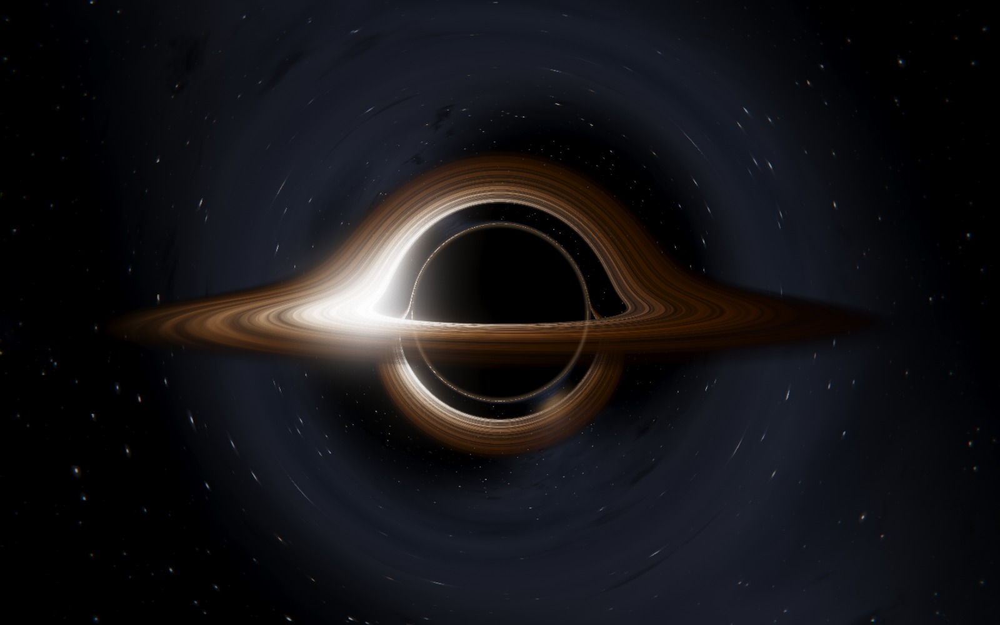
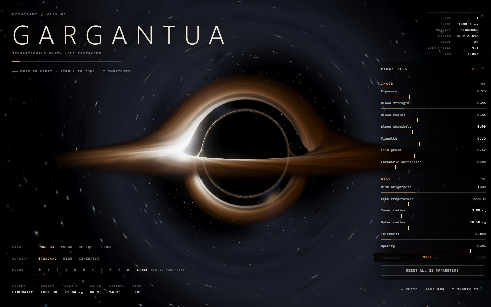
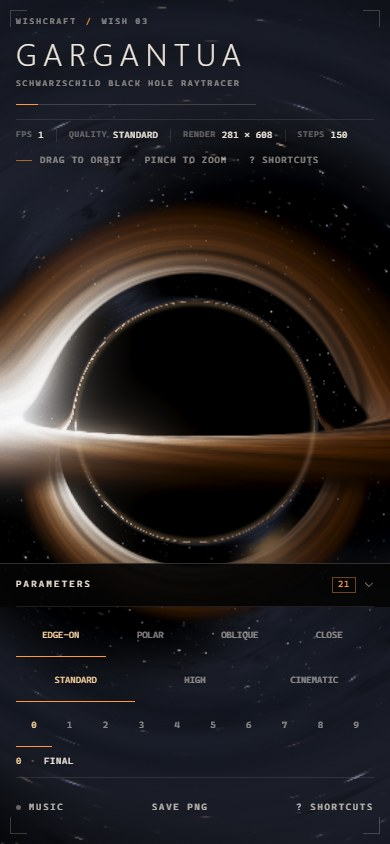
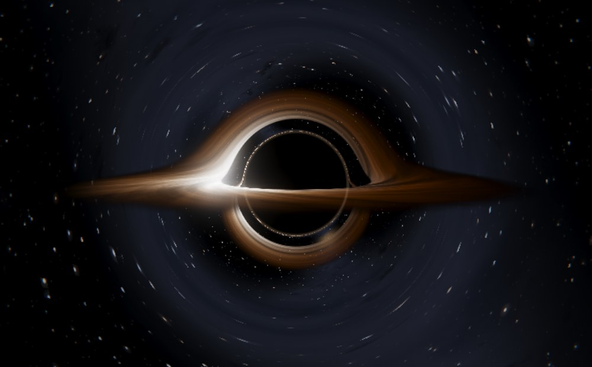
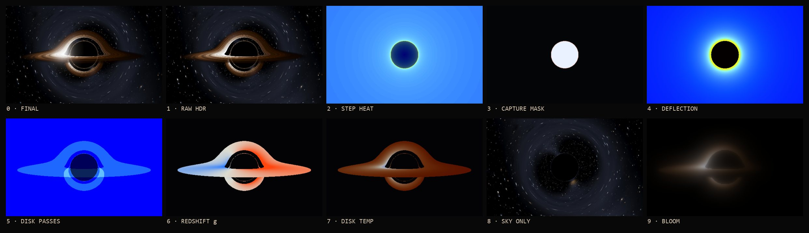

# GARGANTUA / 卡冈图雅

> 每一个像素，都是一条弯折的零测地线。

**Schwarzschild Black Hole Raytracer** — 一个全屏、实时、无需构建的 Three.js / WebGL2 黑洞光线追踪作品。画面主体由一个 Fragment Shader 逐像素积分 Schwarzschild 零测地线产生；没有黑球、平面圆环、贴图、视频或截图。

- 在线入口（作品集内）：`https://120403.xyz/wishcraft/` → `projects/gargantua/`
- 本地入口：在项目目录起任意静态服务器，见下方「运行」
- 技术：原生 HTML / CSS / JavaScript + ES Modules + 本地 Three.js 0.187（MIT）；无构建步骤、无后端、无外部服务
- 物理文档：[`docs/PHYSICS.md`](docs/PHYSICS.md)；验收记录：[`docs/QA_REPORT.md`](docs/QA_REPORT.md)



---

## 运行

ES Modules 需要 HTTP 环境，直接双击 `index.html`（`file://`）无法加载。用任意静态服务器即可：

```bash
# 方式 A：Python（零依赖）
cd projects/gargantua
python -m http.server 5192 --bind 127.0.0.1
# open http://127.0.0.1:5192/

# 方式 A bis：项目内零依赖静态服务器
node tools/serve.mjs               # http://127.0.0.1:5193/

# 方式 B：从仓库根目录构建并预览整个作品集
node scripts/build-site.mjs --only=gargantua --skip-install
node scripts/serve-site.mjs        # http://127.0.0.1:5180/projects/gargantua/
```

推荐 Chrome / Edge / Firefox / Safari 的近期版本，需要 WebGL2 与浮点渲染目标；不支持时页面会显示降级说明，而不是黑屏。

### 验收与自检

```bash
# 物理自检（独立 JS 实现，9 项方程校验）
node tools/physics-check.mjs --json      # → docs/PHYSICS_CHECK.json

# 浏览器验收（自带静态服务器与临时端口；使用仓库 inference 项目的 playwright-core）
node tools/qa.mjs                        # → docs/QA_REPORT.md / QA_FINAL.json / docs/screens/qa-*.png

# 重新生成封面（1600×1000，HUD 关闭）
node tools/cover.mjs                     # → ../../site/assets/covers/gargantua.jpg
```

---

## 什么是真的，什么是艺术

| 部分 | 实现 |
| --- | --- |
| 事件视界 / 阴影 | `u ≥ 1` 的测地线被判定吸收；阴影边界由临界碰撞参数 `b_c = 3√3 M` 决定 |
| 光子环 / 多重像 | 同一光线的多次赤道面穿越，与绕光子球的多圈积分；**不是**叠加的圆环 mesh |
| 引力透镜 | 每像素积分 Binet 方程 `u'' + u = 3Mu²`；天空、盘面、背景星场都被真实弯折 |
| 吸积盘 | 几何薄盘 + 发射/吸收合成；Shakura–Sunyaev 型温度、Keplerian 差速旋转、程序化湍流 |
| Doppler / 红移 | 圆轨道发射体的 `g = √(1 - 3M/r) / (1 - Ω b_z)`；颜色 `T_obs = gT`，亮度 `g⁴` |
| 星空 / 银河 | 程序化哈希星点与 fBm 银河带，无全景贴图；同样经过积分后的方向采样 |
| 后处理 | 手写 HDR bloom（亮度阈值 + mip 链 + tent 升采样）、ACES fitted、暗角、色散、胶片颗粒 |
| 艺术取舍 | 湍流图案、星点分布、银河形态为程序化创作；Schwarzschild 不转动，不含 Kerr 自旋、偏振或辐射转移 |

完整推导、数值边界与「不伪造」原则见 [`docs/PHYSICS.md`](docs/PHYSICS.md)。

---

## 交互

| 操作 | 功能 |
| --- | --- |
| 拖拽 / 滚轮 / 双指 | OrbitControls 环绕 / 缩放（始终注视黑洞） |
| `C` | 电影镜头循环 ↔ 手动观察 |
| `Shift + 1` – `Shift + 4` | 4 个视角预设：EDGE-ON / POLAR / OBLIQUE / CLOSE |
| `0` – `9` | 10 个调试视图 |
| `空格` | 暂停 / 继续时间（盘面湍流与电影镜头一起冻结） |
| `H` | 隐藏 / 显示 HUD |
| `M` | 环境音乐开关（默认关闭，首次点击后按浏览器策略启动） |
| `P` | 保存当前帧 PNG |
| `R` | 21 项参数恢复默认 |
| `?` | 快捷键面板 |

HUD 右侧面板可折叠；移动端自动变为底部抽屉。所有参数、质量档、调试视图、视角预设与音乐开关都会写入 `localStorage`，下次打开自动恢复。

---

## 21 项实时参数

| # | 参数 | 范围 | 默认 | 作用 |
| --- | --- | --- | --- | --- |
| 1 | Exposure | 0.2–3.0 | 0.95 | 曝光 |
| 2 | Bloom strength | 0–2.5 | 0.55 | HDR bloom 强度 |
| 3 | Bloom radius | 0–1 | 0.35 | bloom 扩散半径 |
| 4 | Bloom threshold | 0–3 | 0.90 | 高光阈值 |
| 5 | Vignette | 0–1.5 | 0.55 | 暗角 |
| 6 | Film grain | 0–1 | 0.32 | 胶片颗粒 |
| 7 | Chromatic aberration | 0–3 | 0.40 | 径向色散 |
| 8 | Disk brightness | 0–3 | 1.00 | 盘面亮度 |
| 9 | Peak temperature | 2200–16000 K | 5800 | 内缘峰值温度 |
| 10 | Inner radius | 1.8–8 r_s | 3.00 | 盘内缘（默认 ISCO） |
| 11 | Outer radius | 5–26 r_s | 10.50 | 盘外缘 |
| 12 | Thickness | 0.01–1.6 | 0.160 | 光学厚度参数 |
| 13 | Opacity | 0–1 | 0.86 | 不透明度 |
| 14 | Turbulence | 0–1.5 | 0.95 | 湍流对比度 |
| 15 | Orbital speed | 0–3 | 1.00 | 差速旋转速度 |
| 16 | Doppler beaming | 0–1.5 | 0.90 | `g⁴` beaming 强度 |
| 17 | Gravitational redshift | 0–1.5 | 1.00 | 观测频率/颜色偏移 |
| 18 | Photon ring gain | 0–3 | 1.00 | 临界环受限增益 |
| 19 | Star brightness | 0–3 | 1.00 | 星场亮度 |
| 20 | Galaxy brightness | 0–2 | 0.90 | 银河带亮度 |
| 21 | Field of view | 24–78° | 45 | 相机视场角 |

> 参数面板分组：IMAGE ×7、DISK ×10、OPTICS ×3、CAMERA ×1。

---

## 质量档

| 档位 | DPR 上限 | 主渲染缩放 | 最大积分步数 | 角步长 | Bloom 级数 |
| --- | --- | --- | --- | --- | --- |
| Standard | 1.0× | 0.72 | 150 | 0.085 rad | 4 |
| High | 1.5× | 0.90 | 280 | 0.052 rad | 5 |
| Cinematic | 2.0× | 1.00 | 420 | 0.038 rad | 6 |

像素总量还受 `maxPixels` 上限约束（1.4M / 3.4M / 6.2M），移动端与高 DPR 屏幕不会把 GPU 压死。三档质量可在 HUD 中实时切换。

---

## 调试视图

`0` FINAL · `1` RAW HDR · `2` STEP HEAT · `3` CAPTURE MASK · `4` DEFLECTION · `5` DISK PASSES · `6` REDSHIFT g · `7` DISK TEMP · `8` SKY ONLY · `9` BLOOM

每个视图直接输出对应物理量（步数、捕获、偏折角、穿越次数、`g`、观测温度、透镜天空、bloom 源），用于肉眼验证核心画面不是伪造的。对应关系与色标见 [`docs/PHYSICS.md#6-调试视图与物理量对应`](docs/PHYSICS.md)。

---

## URL 截图 / 自动化接口

```
?shot=1&quality=high&view=edge&debug=0&ui=0&dpr=1&time=7
&params=exposure:1.1,diskTemperature:6400&cam=22,84.5,24
```

| 参数 | 说明 |
| --- | --- |
| `shot=1` | 冻结时间、固定机位、隐藏 HUD，渲染 N 帧后置 `data-ready="true"` |
| `quality` / `view` / `debug` | 质量档 / 视角预设 / 调试视图 |
| `time` / `t` | 冻结的着色器时间（秒） |
| `ui=0` / `hud=0` / `panel=0` | 隐藏界面 |
| `dpr` | 强制像素比（截图可复现） |
| `frames` | 截图模式渲染帧数（默认 3） |
| `params=id:value,...` | 逐项覆盖 21 个参数 |
| `cam=radius,polarDeg,azimuthDeg` | 自定义机位 |

页面暴露 `window.__GARGANTUA__`：`ready`、`getState()`、`getStats()`、`getShaderDiagnostics()`、`setParam(s)`、`setQuality()`、`setDebug()`、`setView()`、`setCameraMode()`、`setMotion()`、`setAudio()`、`setTime()`、`screenshot()`（返回 PNG data URL）。`?shot=1` 时另有 `shot.capture()` 与 `shot.ready`。

---

## 工程结构

```text
projects/gargantua/
├─ index.html                 importmap + canvas + HUD 语义结构
├─ styles/
│  ├─ base.css                画布、字体栈、通用原子
│  └─ hud.css                 电影仪表盘 HUD / 面板 / 移动端抽屉
├─ src/
│  ├─ main.js                 渲染器、全屏 pass、帧循环、URL/持久化/上下文恢复
│  ├─ state.js                21 参数 schema、质量档、调试视图、预设、store
│  ├─ camera.js               OrbitControls + 电影循环 + 4 预设过渡
│  ├─ ui.js                   HUD 构建、遥测、快捷键、错误/帮助浮层
│  ├─ audio.js                可选环境音乐（懒加载、淡入淡出、无错误降级）
│  ├─ post.js                 HDR bloom + ACES/暗角/颗粒/色散合成
│  └─ shaders/blackhole.js    测地线积分、程序化天空、吸积盘、调试视图
├─ vendor/three/              本地 Three.js 0.187（three.module/core + OrbitControls + MIT LICENSE）
├─ assets/audio/              程序化合成环境音乐（CC0 1.0）+ 生成脚本说明
├─ tools/
│  ├─ physics-check.mjs       独立物理自检
│  ├─ qa.mjs / shot.mjs       浏览器验收与截图
│  ├─ serve.mjs               零依赖静态服务器
│  └─ cover.mjs               1600×1000 封面生成
├─ docs/                      PHYSICS.md / QA_REPORT.md / QA_FINAL.json / 截图
└─ wish.json                  作品集集成描述（静态构建）
```

- **无构建**：浏览器直接加载 ES Modules；`wish.json` 使用 `build.mode = "static"`，作品集构建器只复制文件。
- **无外部依赖**：Three.js 已本地 vendor；没有 CDN、字体、贴图、视频或第三方音频采样。

---

## 移动端 / 可访问性 / 稳定性

- 触摸 OrbitControls；HUD 折叠为底部抽屉；隐藏低优先级遥测；触控目标放大。
- DPR 上限与像素预算控制移动端性能；`prefers-reduced-motion` 下默认停在静态 OBLIQUE 机位。
- 状态持久化：质量、21 参数、调试视图、机位、HUD/面板、音乐开关（`localStorage` + 版本化，自动丢弃非法值）。
- WebGL `contextlost` / `contextrestored`：暂停循环、显示可操作浮层、重建 RT 与后处理管线后恢复；创建失败时显示可读的错误页，不黑屏。
- 页面不可见时暂停渲染循环；重新可见时恢复。

---

## 验证

- 物理：`node tools/physics-check.mjs` → **9/9 PASS**（临界碰撞参数、弱场偏折、光子球、红移、ISCO、温度、守恒量），记录在 `docs/PHYSICS_CHECK.json`。
- 浏览器：`node tools/qa.mjs` → **58/58 PASS**（0 failed / 0 skipped），冻结构建上运行；零 console error / page error / console warning、零 HTTP ≥ 400；覆盖 21 参数与钳制、3 质量档、0–9 调试视图与确定性渲染、4 预设、快捷键、HUD/帮助/错误浮层、持久化与清空回默认、移动端、Retina DPR、reduced-motion、WebGL 丢失/恢复、URL 截图确定性（两次独立加载 PNG sha256 相同）、`/projects/gargantua/` 静态子路径、封面与音频资源。记录见 `docs/QA_REPORT.md`、`docs/QA_FINAL.json`（A–G 验收映射，defects 为空）。
- 作品集构建：`node scripts/test-site.mjs`（需 `CHROME_PATH`）通过：3 行作品、零 console error、封面加载、移动端无横向溢出；根 README 有记录。
- 构建：`node scripts/build-site.mjs --only=gargantua --skip-install` 组装到 `_site/projects/gargantua/`，资源全部为相对路径。

### 验收截图

| | |
| --- | --- |
|  |  |
| 1440×900：HUD、21 参数、遥测、dock | 390×844：面板默认收起，黑洞不被遮挡 |
|  |  |
| 无 HUD 的实时积分画面 | `0–9` 调试视图：final / raw HDR / steps / capture / deflection / passes / g / temp / sky / bloom |

上下文丢失恢复浮层见 `docs/evidence/05-context-loss-overlay.jpg`。完整的 31 张浏览器截图、逐项证据、环境与已知限制见 `docs/QA_REPORT.md`。

---

## 授权

- 本项目原创代码与画面：随 WISHCRAFT 仓库发布。
- Three.js r187：MIT，见 [`vendor/three/LICENSE`](vendor/three/LICENSE)。
- 环境音乐 `assets/audio/gargantua-ambient.ogg`：由 `tools/make-audio.py` 程序化合成，**CC0 1.0**，没有第三方采样；详见 [`assets/audio/README.md`](assets/audio/README.md)。
- 字体使用系统字体栈，没有打包第三方字体文件。

---

原始愿望 / issue：[MY-Final/wishcraft#2](https://github.com/MY-Final/wishcraft/issues/2)
